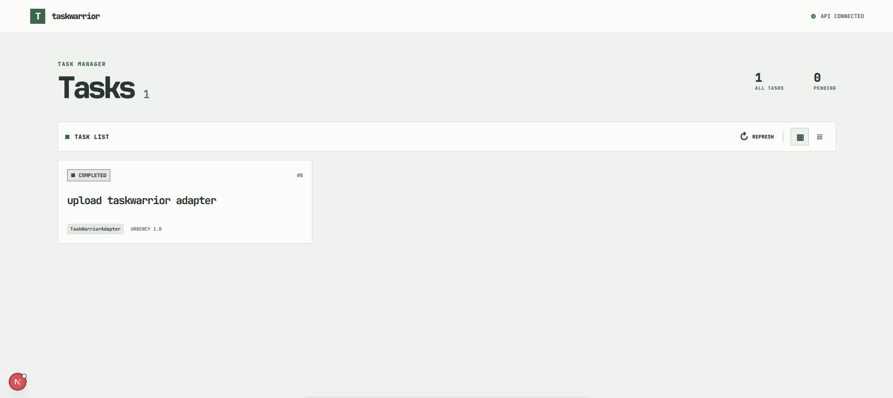

# TaskWarrior Web

A single-page web interface for viewing Taskwarrior tasks from the [TaskWarrior API](https://github.com/Sief-Ali/taskwarrior-api). Built with Next.js, React, TypeScript, and Axios.



> **Status:** `0.4.0` — Dark theme, Taskwarrior gray branding, and Task CRUD and lifecycle actions
> **Current scope:** Read and write access through TaskWarrior API v0.2.0

## Features

- Fetch and display tasks from the TaskWarrior API.
- Switch between box and list layouts.
- Display subtasks beneath their parent when the API includes a `parent` or `parent_uuid` field.
- Show task status, project, and urgency when available.
- Parse Taskwarrior UTC timestamps and display due dates and task times in the viewer's local timezone.
- Refresh tasks and view loading, empty, and error states.
- Create tasks with description, project, priority, due date, and tags.
- Edit task fields and tags, then refresh from the API after each successful mutation.
- Start, stop, complete, and soft-delete tasks from the details panel.
- Responsive layout with bold JetBrains Mono typography and readable system-font fallbacks.
- Dark interface with a restrained gray accent drawn from the official Taskwarrior mark.
- Official Taskwarrior SVG mark in the application header and browser tab.

The API's mutation routes have no authentication or authorization. Protect the API with network or deployment controls before exposing this client to untrusted users. CORS does not provide access control.

## Requirements

- Node.js compatible with the project's dependencies.
- pnpm `12.14.0`.
- The TaskWarrior API running and accessible from the browser.

## Installation

From the repository root, install the workspace dependencies:

```bash
pnpm install
```

Or, if dependencies have already been installed at the repository root, run the client commands below.

## Configuration

The client defaults to `http://localhost:5000/v1` as its API base URL. To use another API URL, set `NEXT_PUBLIC_TASKWARRIOR_API_URL` in `client/.env.local`:

```dotenv
NEXT_PUBLIC_TASKWARRIOR_API_URL=http://localhost:5000/v1
```

The value is the API base URL; the client appends `/tasks` when requesting the task list. Restart the Next.js server after changing this setting.

The API must allow requests from the web client's origin. The backend allows `http://localhost:3000` and `http://127.0.0.1:3000` by default.

## Running the Web App

From the repository root:

```bash
pnpm --filter client dev
```

Or from the client directory:

```bash
cd client
pnpm dev
```

Open [http://localhost:3000](http://localhost:3000) in a browser. Start the backend as well so the page can load tasks.

To start both applications together from the repository root, use:

```bash
pnpm dev
```

## API

The web app uses `GET /tasks` and `GET /tasks/:uuid` for reading, plus the v0.2.0 create, modify, complete, start, stop, and soft-delete routes. Successful mutations return `204 No Content`; the client refreshes task data rather than treating a mutation response as a task. A task must include an `id`, `uuid`, `description`, and `status`. Taskwarrior timestamps in `YYYYMMDDTHHmmssZ` format are displayed in the browser's local timezone; the original UTC timestamp is available as the time's tooltip.

For the complete API setup, configuration, and endpoint documentation, see the [TaskWarrior API README](https://github.com/Sief-Ali/taskwarrior-api). The interactive API reference is available at `http://localhost:5000/v1/api-docs/` when using the backend's `/v1` prefix.

The frontend roadmap for upgrading to the API's task mutation features is in the [API v0.2.0 upgrade plan](./docs/api-v0.2.0-upgrade-plan.md).

## Project Structure

```text
src/
├── app/                 # Next.js page, layout, and global styles
├── components/tasks/    # Task list, task cards, and view toolbar
├── hooks/               # React hooks for task data
└── lib/                 # Axios client and task API functions
```

## Scripts

Run these from `client/`, or prefix them with `pnpm --filter client` from the repository root.

| Command | Description |
|---|---|
| `pnpm dev` | Start the Next.js development server |
| `pnpm build` | Create a production build |
| `pnpm start` | Serve the production build |
| `pnpm lint` | Run ESLint |
